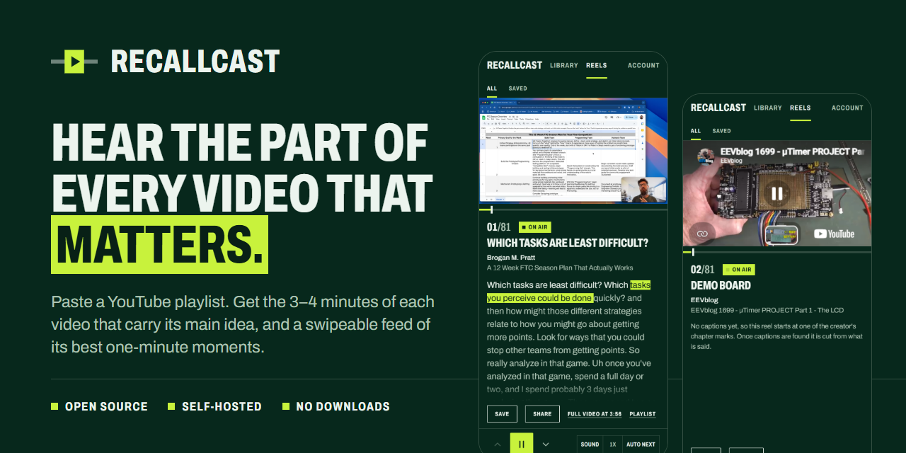
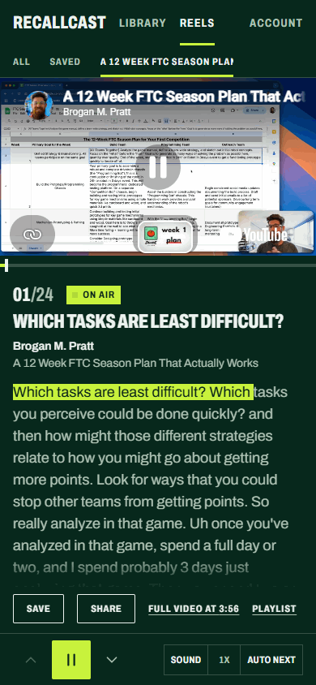
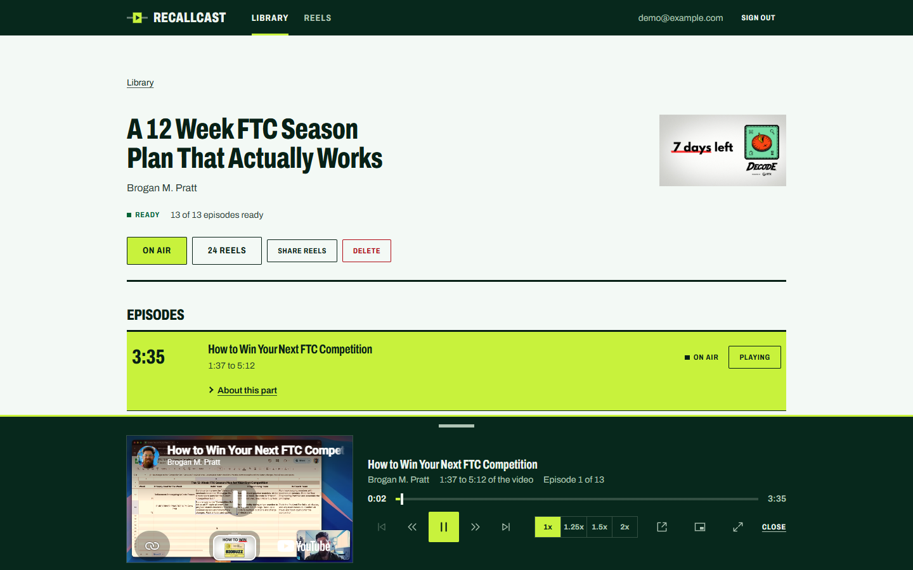
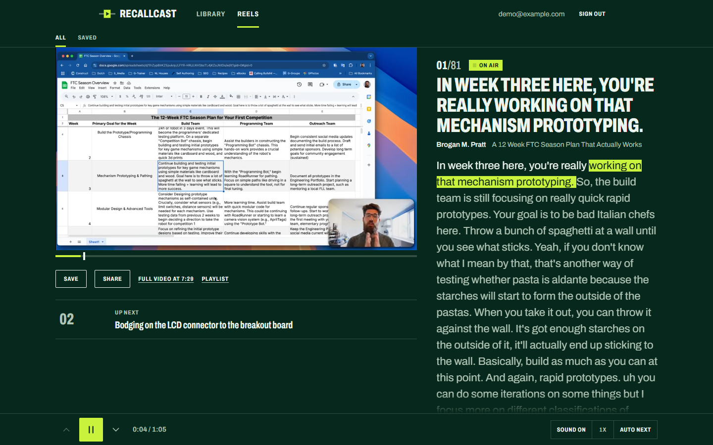
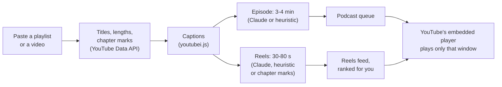

<p align="center">
  
</p>

<p align="center">
  <b>Paste a YouTube playlist. RecallCast finds the 3 to 4 minutes of each video that carry its main idea, plays them back to back like a podcast, and cuts the best one-minute moments into a feed you swipe.</b>
</p>

<p align="center">
  <a href="https://github.com/vaseem00/recallcast/actions/workflows/ci.yml"></a>
  <a href="LICENSE"></a>
  
  
  
  
</p>

---

Long videos hide a few minutes that matter. RecallCast reads each video's transcript, picks those minutes, and plays them from the original video in YouTube's own player. Nothing is downloaded or re-hosted, and the creator keeps the view.

## Demo

<table>
  <tr>
    <td width="320" valign="top">
      
    </td>
    <td valign="top">
      <p><b>The reels feed on a phone.</b> Each reel is one self-contained minute of a long video. The line being spoken is highlighted under the player. Swipe up for the next reel.</p>
      <p><b>The feed has an order.</b> Every playlist takes turns near the top. Each one plays as a series from part 1. Reels you finish, save or share move their playlist up. Reels you skip in the first 3 seconds move it down.</p>
      <p><b>Every video gets reels.</b> When a video has no captions, its reels start at the creator's chapter marks.</p>
      <p><b>Share a reel or a whole feed</b> with a link. It plays without an account.</p>
    </td>
  </tr>
</table>

| A playlist as a podcast queue | Reels on a wide screen |
|---|---|
|  |  |

<sub>The demo shows public YouTube videos by Brogan M. Pratt, EEVblog and Creator Magic, played in YouTube's embedded player.</sub>

## Features

- **One episode per video.** It is a continuous 150 to 255 s window that starts where a thought starts and ends after the point lands. It comes with a title, a summary and the reason it was chosen. Videos of 4.5 minutes or less play in full.
- **Reels.** Moments of 30 to 80 s, up to one per five minutes of video, in a swipe feed with read-along captions. You can save them, share them, and use keyboard shortcuts.
- **A feed that learns from you.** It weaves your playlists together in series order and reacts to what you finish and what you skip. The ranking is pure and deterministic ([feed-rank.ts](src/lib/feed-rank.ts)).
- **AI is optional.** Claude picks the moments when you give it a key. Without one, a free heuristic picks the densest stretches.
- **Works without captions.** Reels fall back to the description's chapter marks, then to position. You can paste a transcript to get a proper pick.
- **Self-hosted and small.** One Node server and one SQLite file. A background job queue runs inside the server. Docker and Railway configs are included.
- **Built carefully.** Passwords are hashed with scrypt and session tokens are stored hashed. There are rate limits, same-origin checks, a strict Content-Security-Policy and daily caps on spending. The repo has 718 unit tests and an end-to-end smoke test.

## What you need

| | Needed? | What it is for | Cost |
|---|---|---|---|
| **Node.js 24 or newer** | Yes | Runs the app. SQLite is built into Node, so there is no database server | Free |
| **YouTube Data API v3 key** (`YOUTUBE_API_KEY`) | For real playlists | Reads the titles, lengths, thumbnails and chapter marks of playlists and videos | Free. The default quota is 10,000 units a day, and importing a playlist costs a few units |
| **Anthropic API key** (`ANTHROPIC_API_KEY`) | Optional | Claude reads each transcript, picks the episode and the reels, and writes their titles | Paid per use (Claude Haiku by default). Without a key, a free heuristic picks |
| Captions | No key | Downloaded from YouTube by the `youtubei.js` package (`TRANSCRIPT_PROVIDER=youtubei`) | Free |

With no keys at all, **mock mode** runs the whole app offline on a made-up playlist.

> [!IMPORTANT]
> Put your keys in `.env.local`, never in `.env.example` or in code. Git ignores `.env.local` and every other `.env*` file except `.env.example`.

## Tutorial: your first feed

### 1. Install

```bash
git clone https://github.com/vaseem00/recallcast.git
cd recallcast
npm install
cp .env.example .env.local        # Windows PowerShell: Copy-Item .env.example .env.local
```

### 2. Try it with no keys

```bash
npm run dev
```

Open http://localhost:3000 and create an account. The email is only a login name, and it stays on your machine. Paste any YouTube playlist link. Mock mode answers with a made-up playlist of 3 videos called "How Memory Works". You can click through its episodes, open **Reels** and try every button. The mock videos are not real, so YouTube's player shows "Video unavailable".

### 3. Get a free YouTube Data API key

1. Open the [Google Cloud console](https://console.cloud.google.com/) and create a project, or pick one you have.
2. Go to **APIs & Services → Library**, search for **YouTube Data API v3** and press **Enable**.
3. Go to **APIs & Services → Credentials → Create credentials → API key**.
4. Recommended: edit the key and, under **API restrictions**, allow only **YouTube Data API v3**.
5. Put it in `.env.local`:

   ```ini
   YOUTUBE_PROVIDER=api
   YOUTUBE_API_KEY=paste-your-key-here
   TRANSCRIPT_PROVIDER=youtubei
   ```

Stop the dev server (Ctrl+C) and start it again so it reads the new settings.

### 4. Make your first feed

1. In **Library**, paste a playlist link such as `https://www.youtube.com/playlist?list=...` or a single video link, then press **Make episodes**.
2. The playlist goes from *queued* to *processing* to *ready* in about a minute. Each video gets one episode.
3. Press **Play all** to hear the episodes back to back. **About this part** says why each window was chosen.
4. Open **Reels** and swipe. On a computer, use these keys: ↑/↓ or K/J move between reels, Space plays or pauses, ←/→ seek 5 s, M mutes, S saves.
5. Press **Share** on a reel, or **Share reels** on a playlist page, to get a public link that plays without an account.

### 5. Optional: let Claude choose the moments

Create a key in the [Anthropic Console](https://console.anthropic.com/), then add to `.env.local`:

```ini
AI_PROVIDER=anthropic
ANTHROPIC_API_KEY=paste-your-key-here
```

Each video with captions then costs up to two small Claude requests: one for the episode and one for the reels. The Claude path has been tested against a fake client only, so run one video first and read what it picks (see [limitations](docs/limitations.md)).

### 6. Optional: open it on your phone

A [Cloudflare quick tunnel](https://developers.cloudflare.com/cloudflare-one/connections/connect-networks/do-more-with-tunnels/trycloudflare/) gives your local server a temporary public `https://` address:

```bash
npm run build
cloudflared tunnel --url http://localhost:3000   # prints https://<random-words>.trycloudflare.com
```

Set `APP_URL` to the printed address and `TRUST_PROXY_HOPS=1` in `.env.local`, then run `npm start` and open the address on your phone. Next prints a warning about `output: standalone` when you use `npm start`; it is safe to ignore locally.

> [!WARNING]
> Anyone with the tunnel address can sign up and use your server, and with it your API keys and their quota. Stop the tunnel when you are done.

### 7. Deploy

The app needs one long-running Node server with a persistent disk. Serverless hosting does not work. The repo ships a `Dockerfile` and `railway.json`. [docs/deploy.md](docs/deploy.md) walks through the Railway setup step by step: the volume, the variables, the first-run checklist, backups, logs and rollback.

## How it works



Each step is a job in a SQLite-backed queue, so work survives restarts. Rate limits are retried and failures stay contained to one video. Every window is clamped to the video and snapped to caption boundaries, so playback never starts mid-sentence. The full story is in [docs/how-it-works.md](docs/how-it-works.md).

## Configuration

Everything is an environment variable. [`.env.example`](.env.example) lists them all with comments. [docs/configuration.md](docs/configuration.md) explains each one: the providers, the limits that bound your API bill, the worker, the proxy setting and mock mode.

## Development

| Command | What it does |
|---|---|
| `npm run dev` | Starts the dev server at http://localhost:3000. The job worker runs inside it |
| `npm run build`, then `npm start` | Builds and runs the production server |
| `npm test` | Runs the vitest unit and route tests. They use mocks and an in-memory database, and never call a paid API |
| `npm run typecheck` / `npm run lint` | Runs TypeScript and ESLint |
| `npm run smoke` | Runs the end-to-end smoke test against `npm start`, with every provider mocked. It is a Windows PowerShell script; run `npm run build` first |
| `node scripts/backup.mjs [dir]` | Makes an online SQLite backup (`VACUUM INTO`) to a timestamped file |
| `node scripts/reset-password.mjs <email>` | Resets a password from the server: sets a random one and prints it once |

```
src/app          pages and API routes (Next.js App Router)
src/components   the players, the reels feed and other client components
src/lib          database, auth, providers (YouTube, captions, AI), job queue, feed ranking
src/styles       design tokens and CSS modules
scripts/         smoke test, backup, password reset, Docker entrypoint
docs/            how it works, configuration, deployment, security, design, spec
```

## Limitations

- **Captions come from an unofficial route.** YouTube rate-limits it per address and can change it without notice. YouTube's API terms do not provide for reading captions this way. Read the terms before you run a public instance. For real traffic, plan a paid transcript service behind the `TranscriptProvider` interface.
- **Single server.** SQLite and the in-process worker mean exactly one replica with a persistent disk.
- **No email.** There is no verification and no reset link. Password resets are done by an operator.

The full list, including what has and has not been tested against the real services, is in [docs/limitations.md](docs/limitations.md).

## Contributing

Issues and pull requests are welcome. [CONTRIBUTING.md](CONTRIBUTING.md) explains the setup, the checks a pull request must pass and the few house rules. To report a security problem privately, see [SECURITY.md](SECURITY.md).

## License

[MIT](LICENSE). RecallCast is not affiliated with YouTube or Google. Videos belong to their creators. They play in YouTube's embedded player and are never downloaded or re-hosted.

Built with [Next.js](https://nextjs.org/), [React](https://react.dev/), [youtubei.js](https://github.com/LuanRT/YouTube.js), the [Anthropic TypeScript SDK](https://github.com/anthropics/anthropic-sdk-typescript), [zod](https://zod.dev/) and the [Archivo](https://fonts.google.com/specimen/Archivo) typeface (SIL Open Font License).
